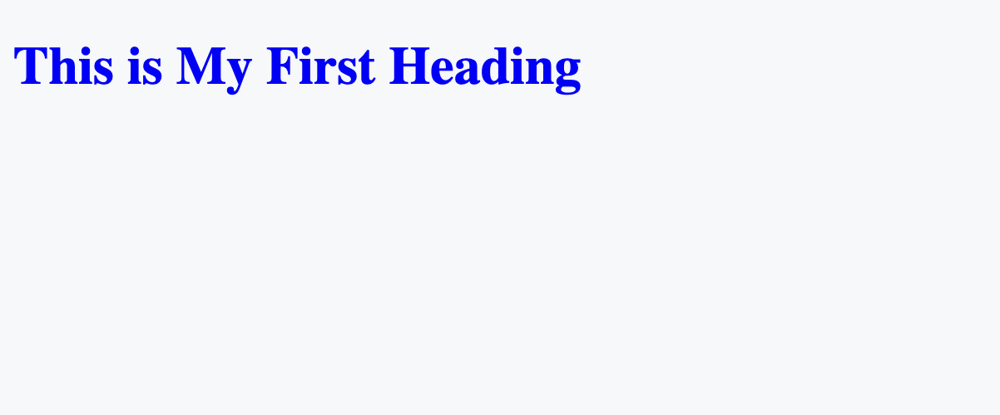
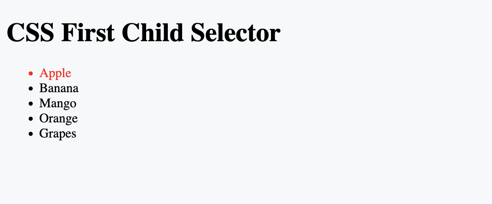

<h1 align="center">Complete CSS Notes</h1>

## Table of Contents

1. [Introduction to CSS](#1-introduction-to-css)
2. [Basic CSS Syntax](#2-basic-css-syntax)
3. [Ways to Add CSS](#3-ways-to-add-css)
4. [CSS Selectors](#4-css-selectors)
5. [Pseudo-Classes](#5-pseudo-classes)
6. [Pseudo-Elements](#6-pseudo-elements)
7. [Cascade, Specificity and Inheritance](#7-cascade-specificity-and-inheritance)
8. [CSS Colors](#8-css-colors)
9. [Background Properties](#9-background-properties)
10. [CSS Units and Values](#10-css-units-and-values)
11. [CSS Functions](#11-css-functions)
12. [Width, Height and Sizing](#12-width-height-and-sizing)
13. [CSS Box Model](#13-css-box-model)
14. [Margin Properties](#14-margin-properties)
15. [Padding Properties](#15-padding-properties)
16. [Border and Outline](#16-border-and-outline)
17. [Font Properties](#17-font-properties)
18. [Text Properties](#18-text-properties)
19. [Display, Visibility and Overflow](#19-display-visibility-and-overflow)
20. [CSS Positioning](#20-css-positioning)
21. [Flexbox](#21-flexbox)
22. [CSS Grid](#22-css-grid)
23. [Images and Media](#23-images-and-media)
24. [Lists and Tables](#24-lists-and-tables)
25. [Forms and Controls](#25-forms-and-controls)
26. [Cursor and Interaction](#26-cursor-and-interaction)
27. [Shadows and Visual Effects](#27-shadows-and-visual-effects)
28. [Transform Properties](#28-transform-properties)
29. [Transition Properties](#29-transition-properties)
30. [Animation Properties](#30-animation-properties)
31. [Responsive Design and Media Queries](#31-responsive-design-and-media-queries)
32. [CSS Variables](#32-css-variables)
33. [Logical Properties](#33-logical-properties)
34. [Accessibility and Best Practices](#34-accessibility-and-best-practices)
35. [Practical Project 1 — Product Card](#35-practical-project-1--product-card)
36. [Practical Project 2 — Responsive Navbar](#36-practical-project-2--responsive-navbar)
37. [Quick Reference — Common CSS Properties](#37-quick-reference--common-css-properties)
38. [CSS Learning Checklist](#38-css-learning-checklist)
39. [Useful Resources](#39-useful-resources)

---

# 1. Introduction to CSS

## What is CSS?

CSS ka full form **Cascading Style Sheets** hai.

CSS ek stylesheet language hai jiska use HTML documents ki appearance aur layout ko control karne ke liye hota hai. Iski help se hum website ko attractive, well-designed aur responsive bana sakte hain.

CSS ki help se hum webpage ke elements ka color, size, spacing, position aur overall design control karte hain.

### CSS is used to control:

- Colors and backgrounds
- Fonts and text styling
- Width and height
- Margin and padding
- Borders and shadows
- Element positioning
- Flexbox and Grid layouts
- Transitions and animations
- Responsive website layouts

### HTML, CSS and JavaScript

| Technology | Purpose |
|---|---|
| HTML | Webpage ka structure banata hai |
| CSS | Webpage ki styling aur layout control karta hai |
| JavaScript | Webpage mein behaviour aur interactivity add karta hai |

---

# 2. Basic CSS Syntax

CSS rules ek fixed syntax ko follow karte hain. Is syntax ki help se hum HTML elements par styling apply karte hain.

### Syntax

```css
selector {
    property: value;
}
```

### Example

```css
h1 {
    color: blue;
    font-size: 32px;
}
```

### Key Components

1. **Selector:** Ye us HTML element ko select karta hai jise hum style karna chahte hain.
2. **Property:** Ye define karti hai ki humein kis style ko change karna hai.
3. **Value:** Ye batati hai ki property ko kaunsi setting deni hai.
4. **Declaration:** Property aur value ke combination ko declaration kehte hain.
5. **Declaration Block:** Curly brackets `{ }` ke andar likhi gayi sabhi declarations ko declaration block kehte hain.

### Example Breakdown

```css
h1 {
    color: red;
    font-size: 32px;
}
```

- `h1` — Selector
- `color` — Property
- `blue` — Value
- `color: red;` — Declaration
- `{ }` — Declaration Block

---

# 3. Ways to Add CSS

HTML document mein CSS add karne ke three main methods hote hain.

## 1. Inline CSS

Inline CSS mein CSS ko directly HTML element ke andar `style` attribute ki help se likha jata hai.

### Example

```html
<p style="color: red; font-size: 20px;">
    Hello World
</p>
```

**Use:** Jab kisi specific HTML element par styling apply karni ho.

## 2. Internal CSS

Internal CSS mein CSS ko HTML document ke andar `<style>` element mein likha jata hai.

### Example

```html
<!DOCTYPE html>
<html lang="en">
<head>
    <title>Internal CSS</title>

    <style>
        p {
            color: red;
            font-size: 20px;
        }
    </style>
</head>
<body>

    <p>Hello World</p>

</body>
</html>
```
**Use:** Jab sirf ek HTML page ko style karna ho.

## 3. External CSS (Recommended)

External CSS mein CSS ko ek separate file mein likha jata hai. Is file ka naam usually `style.css` rakha jata hai aur ise HTML document ke saath connect kiya jata hai.

### HTML File

```html
<!DOCTYPE html>
<html lang="en">
<head>
    <title>External CSS</title>

    <link rel="stylesheet" href="style.css">
</head>
<body>

    <h1>Hello World</h1>

</body>
</html>
```

### CSS File (style.css)

```css
h1 {
    color: blue;
    font-size: 32px;
}
```

**Use:** Multiple pages wali websites ke liye ye best method hai, kyunki ek hi CSS file se multiple HTML pages ko style kiya ja sakta hai.

---

# 4. CSS Selectors

CSS selectors ka use HTML elements ko select karne ke liye hota hai, jin par hum styling apply karna chahte hain.

## 1. Universal Selector (`*`)

Ye webpage ke sabhi HTML elements ko select karta hai.

```css
* {
    box-sizing: border-box;
    margin: 0;
    padding: 0;
}
```

## 2. Element Selector

Ye kisi particular HTML tag ke sabhi elements ko select karta hai.

```css
p {
    color: #333;
    font-size: 18px;
}
```

## 3. Class Selector (`.`)

Ye un sabhi HTML elements ko select karta hai jinke paas same class name hota hai.

```css
.card {
    background-color: white;
    padding: 20px;
}
```

### HTML

```html
<div class="card">
    This is a card.
</div>
```

## 4. ID Selector (`#`)

Ye us HTML element ko select karta hai jiske paas specified ID hoti hai.

```css
#header {
    background-color: black;
    color: white;
}
```

### HTML

```html
<header id="header">
    Website Header
</header>
```

## 5. Grouping Selector (`,`)

Iska use multiple selectors par same CSS properties apply karne ke liye hota hai.

```css
h1, h2, p {
    font-family: Arial, sans-serif;
    color: #333;
}
```

## 6. Descendant Selector (Space)

Ye kisi element ke andar kahin bhi present matching elements ko select karta hai.

```css
.card p {
    color: gray;
}
```

Ye `.card` ke andar present sabhi `<p>` elements ko select karega, chahe woh directly andar hon ya kisi doosre element ke andar nested hon.

## 7. Child Selector (`>`)

Ye sirf kisi element ke direct children ko select karta hai.

```css
nav > a {
    text-decoration: none;
    color: black;
}
```

## 8. Adjacent Sibling Selector (`+`)

Ye kisi element ke immediately baad aane wale pehle matching sibling element ko select karta hai.

```css
h2 + p {
    margin-top: 0;
}
```

## 9. General Sibling Selector (`~`)

Ye kisi element ke baad aane wale matching sibling elements ko select karta hai.

```css
h2 ~ p {
    color: gray;
}
```

## 10. Attribute Selector (`[]`)

Ye elements ko unke attributes ya attribute values ke basis par select karta hai.

```css
input[type="email"] {
    border: 1px solid gray;
}
```

```css
a[target="_blank"] {
    color: purple;
}
```

### Quick Selector Reference

| Selector | Meaning |
|---|---|
| `*` | Sabhi elements |
| `p` | Sabhi paragraph elements |
| `.box` | `box` class wale elements |
| `#header` | `header` ID wala element |
| `h1, p` | Grouping selector |
| `.card p` | Descendant selector |
| `.card > p` | Direct child selector |
| `h2 + p` | Adjacent sibling |
| `h2 ~ p` | General sibling |
| `input[type="text"]` | Attribute selector |

---

# 5. Pseudo-Classes

Pseudo-classes ka use HTML elements ko unki state, position ya condition ke basis par select karne ke liye hota hai.

### Syntax

```css
selector:pseudo-class {
    property: value;
}
```

### Example

```css
a:hover {
    color: red;
}
```

Jab mouse pointer link ke upar jayega, tab us link ka color red ho jayega.

## Common Pseudo-Classes

| Pseudo-Class | Use |
|---|---|
| `:hover` | Jab mouse pointer element ke upar ho |
| `:focus` | Jab element focus receive kare |
| `:focus-visible` | Jab appropriate condition mein focus indicator show ho |
| `:active` | Jab element activate ho raha ho |
| `:visited` | Pehle visit kiye gaye links |
| `:link` | Abhi tak visit nahi kiye gaye links |
| `:checked` | Checked checkbox ya radio button |
| `:disabled` | Disabled form control |
| `:enabled` | Enabled form control |
| `:required` | Required input field |
| `:valid` | Validation pass karne wala input |
| `:invalid` | Validation fail karne wala input |
| `:first-child` | Parent ka first child |
| `:last-child` | Parent ka last child |
| `:nth-child(n)` | Particular position par present child |
| `:not()` | Jo given selector ko match nahi karta |
| `:is()` | List mein diye gaye kisi bhi selector ko match karta hai |
| `:where()` | `:is()` jaisa, lekin zero specificity ke saath |
| `:root` | Root HTML element |
| `:empty` | Aisa element jiske andar koi child nahi hai |

### Example 1 — Hover

---

**index.html**

```html
<!DOCTYPE html>
<html lang="en">
<head>
    <meta charset="UTF-8">
    <meta name="viewport" content="width=device-width, initial-scale=1.0">

    <title>Button Hover Effect</title>

    <!-- CSS File -->
    <link rel="stylesheet" href="style.css">
</head>
<body>

    <h1>CSS Hover Effect</h1>

    <button>Hover Me</button>

</body>
</html>
```
**style.css**

```css
button:hover {
    background-color: blue;
    color: white;
}
```

**Output:**




### Example 2 — First Child

---

**index.html**


```html
<!DOCTYPE html>
<html lang="en">
<head>
    <meta charset="UTF-8">
    <meta name="viewport" content="width=device-width, initial-scale=1.0">

    <title>First Child Selector</title>

    <!-- CSS File -->
    <link rel="stylesheet" href="style.css">
</head>
<body>

    <h1>CSS First Child Selector</h1>

    <ul>
        <li>Apple</li>
        <li>Banana</li>
        <li>Mango</li>
        <li>Orange</li>
        <li>Grapes</li>
    </ul>

</body>
</html>
```
**style.css**

```css
li:first-child {
    color: red;
}
```

**Output :**



### Example 3 — Last Child

---

```css
li:last-child {
    color: green;
}
```

### Example 4 — Odd and Even Children

```css
li:nth-child(odd) {
    background-color: #f2f2f2;
}

li:nth-child(even) {
    background-color: #ddd;
}
```

### Example 5 — Disabled Button

```css
button:disabled {
    cursor: not-allowed;
    opacity: 0.5;
}
```

---

# 6. Pseudo-Elements

Pseudo-elements ka use HTML element ke kisi specific part ko style karne ya decorative content create karne ke liye hota hai.

### Syntax

```css
selector::pseudo-element {
    property: value;
}
```

### Example

```css
p::first-letter {
    font-size: 32px;
    color: red;
}
```

## Common Pseudo-Elements

| Pseudo-Element | Use |
|---|---|
| `::before` | Element ke content se pehle generated content add karta hai |
| `::after` | Element ke content ke baad generated content add karta hai |
| `::first-letter` | First letter ko style karta hai |
| `::first-line` | First line ko style karta hai |
| `::selection` | Selected text ko style karta hai |
| `::placeholder` | Placeholder text ko style karta hai |
| `::marker` | List markers ko style karta hai |
| `::file-selector-button` | File input button ko style karta hai |

### Example 1 — Before

```css
.heading::before {
    content: "★ ";
    color: orange;
}
```

### Example 2 — After

```css
.button::after {
    content: " →";
}
```

### Example 3 — Placeholder

```css
input::placeholder {
    color: gray;
    font-size: 14px;
}
```

### Example 4 — Selection

```css
::selection {
    background-color: yellow;
    color: black;
}
```

**Note:** `::before` aur `::after` se generated content display karne ke liye usually `content` property ki zarurat hoti hai.

---

# 7. Cascade, Specificity and Inheritance

Ye three concepts decide karte hain ki HTML elements par CSS styles kis tarah apply hongi.

## 1. Cascade

Cascade woh process hai jiske through browser decide karta hai ki jab ek hi element par multiple CSS rules apply ho rahe hon, toh unmein se kaunsi declaration apply hogi.

## 2. Specificity

Specificity kisi selector ki priority ya weight hoti hai. Iska use conflicting CSS rules mein winner decide karne ke liye hota hai.

### General Specificity Order

1. Inline styles
2. ID selectors
3. Class, attribute aur pseudo-class selectors
4. Element aur pseudo-element selectors

## 3. Inheritance

Inheritance ka matlab hai ki kuch CSS properties parent element se automatically uske child elements tak pass ho jati hain.

Example ke liye, `color` aur `font-family` commonly inherited properties hain.

## 4. Source Order

Agar do declarations ki priority aur specificity same hai, toh generally baad mein likhi gayi declaration apply hoti hai.

## 5. !important

`!important` rule kisi declaration ko cascade mein higher priority deta hai.

```css
p {
    color: red !important;
}
```

Bina zarurat `!important` ka use avoid karna chahiye.

### Specificity Example

```css
p {
    color: blue;
}

.note {
    color: green;
}

#intro {
    color: red;
}
```

Agar same paragraph teeno selectors ko match karta hai, toh in declarations mein normally ID selector ki priority sabse zyada hogi.

---

# 8. CSS Colors

CSS mein text, background, borders aur doosre elements ke colors define karne ke liye different formats available hain.

## 1. Named Colors

Color ka naam directly likhkar use kar sakte hain.

```css
h1 {
    color: red;
}
```

Examples:

- red
- blue
- black
- white
- green
- yellow
- purple

## 2. HEX Colors

HEX ek hexadecimal color format hai.

```css
p {
    color: #ff6600;
}
```

## 3. RGB Colors

RGB ka full form Red, Green and Blue hai.

```css
div {
    color: rgb(255, 100, 0);
}
```

## 4. RGBA Colors

RGBA mein RGB ke saath alpha channel bhi hota hai, jo transparency control karta hai.

```css
section {
    background-color: rgba(0, 0, 0, 0.5);
}
```

## 5. HSL Colors

HSL ka full form Hue, Saturation and Lightness hai.

```css
h2 {
    color: hsl(20, 100%, 50%);
}
```

## 6. Transparent

Isse color completely transparent ho jata hai.

```css
.box {
    background-color: transparent;
}
```

### Common Color Formats

| Format | Example |
|---|---|
| Named | `red` |
| HEX | `#ff0000` |
| RGB | `rgb(255, 0, 0)` |
| RGBA | `rgba(255, 0, 0, 0.5)` |
| HSL | `hsl(0, 100%, 50%)` |
| Transparent | `transparent` |

## Related Color Properties

| Property | Use |
|---|---|
| `color` | Text ya foreground color set karta hai |
| `opacity` | Pore element ki transparency set karta hai |
| `accent-color` | Supported controls ka accent color set karta hai |
| `caret-color` | Input mein text cursor ka color set karta hai |
| `color-scheme` | Light aur dark color schemes ke support ko indicate karta hai |

### Example

```css
:root {
    accent-color: #2563eb;
    color-scheme: light;
}
```

---

# 9. Background Properties

Background properties ka use kisi element ka background color, image, position, size aur display control karne ke liye hota hai.

### Example

```css
body {
    background-color: #f5f7fb;
    background-image: url("background.jpg");
    background-repeat: no-repeat;
    background-position: center;
    background-size: cover;
    background-attachment: fixed;
}
```

## Background Properties

| Property | Use |
|---|---|
| `background` | Background settings ke liye shorthand property |
| `background-color` | Background color set karta hai |
| `background-image` | Image ya gradient add karta hai |
| `background-repeat` | Image repeat hogi ya nahi, control karta hai |
| `background-position` | Background image ki position set karta hai |
| `background-size` | Background image ka size set karta hai |
| `background-attachment` | Scrolling ke saath background ka behaviour control karta hai |
| `background-origin` | Background position karne ke liye box set karta hai |
| `background-clip` | Background kis area tak paint hoga, define karta hai |
| `background-blend-mode` | Background layers ko blend karta hai |

## Background Gradient

Gradient ek smooth color transition create karta hai, jisme two ya more colors use kiye ja sakte hain.

### Linear Gradient

```css
.hero {
    background: linear-gradient(135deg, #2563eb, #9333ea);
}
```

### Radial Gradient

```css
.box {
    background: radial-gradient(circle, #ffffff, #2563eb);
}
```

### Conic Gradient

```css
.box {
    background: conic-gradient(red, yellow, green, blue);
}
```

## Useful Background Values

### Background Size

```css
background-size: cover;
background-size: contain;
background-size: auto;
```

- `cover` — Background area ko completely cover karta hai.
- `contain` — Image ko poora background area ke andar show karta hai.
- `auto` — Jahan applicable ho, image ka original size use karta hai.

### Background Repeat

```css
background-repeat: no-repeat;
background-repeat: repeat;
background-repeat: repeat-x;
background-repeat: repeat-y;
```

### Background Position

```css
background-position: center;
background-position: top right;
background-position: bottom left;
```

---

# 10. CSS Units and Values

CSS units ka use HTML elements ka size, spacing aur dimensions define karne ke liye hota hai.

## 1. Absolute Units

Absolute units ki reference size fixed hoti hai.

| Unit | Meaning |
|---|---|
| `px` | CSS pixel |
| `cm` | Centimeter |
| `mm` | Millimeter |
| `in` | Inch |
| `pt` | Point |
| `pc` | Pica |

Normal web layouts mein `px` ka commonly use hota hai.

## 2. Relative Units

Relative units kisi doosre size ya viewport par depend karti hain.

| Unit | Meaning |
|---|---|
| `%` | Kisi relevant containing size ka percentage |
| `em` | Element ke font size ke relative |
| `rem` | Root element ke font size ke relative |
| `vw` | Viewport width ka 1% |
| `vh` | Viewport height ka 1% |
| `dvw` | Dynamic viewport width ka 1% |
| `dvh` | Dynamic viewport height ka 1% |
| `vmin` | Viewport ki chhoti dimension ka 1% |
| `vmax` | Viewport ki badi dimension ka 1% |
| `ch` | `0` character ki width ke basis par |
| `fr` | CSS Grid mein available space ka fraction |

### Example 1 — REM

```css
h1 {
    font-size: 2rem;
}
```

### Example 2 — Percentage

```css
.container {
    width: 80%;
}
```

### Example 3 — Viewport Width

```css
.box {
    width: 50vw;
}
```

### Example 4 — Viewport Height

```css
.hero {
    min-height: 100vh;
}
```

---

# 11. CSS Functions

CSS functions ka use values calculate karne, sizes define karne, gradients create karne aur values reuse karne ke liye hota hai.

## 1. calc()

Mathematical calculations perform karta hai.

```css
.container {
    width: calc(100% - 40px);
}
```

## 2. min()

Di gayi values mein se chhoti value select karta hai.

```css
.container {
    width: min(100%, 1200px);
}
```

## 3. max()

Di gayi values mein se badi value select karta hai.

```css
.heading {
    font-size: max(16px, 2vw);
}
```

## 4. clamp()

Kisi value ko minimum aur maximum limit ke beech rakhta hai.

```css
h1 {
    font-size: clamp(24px, 4vw, 48px);
}
```

## 5. var()

CSS custom property ki value use karta hai.

```css
.box {
    color: var(--primary-color);
}
```

## 6. minmax()

Minimum aur maximum sizes define karta hai. Iska use commonly CSS Grid mein hota hai.

```css
.grid {
    grid-template-columns: repeat(3, minmax(200px, 1fr));
}
```

## 7. repeat()

Grid track definitions ko repeat karta hai.

```css
.grid {
    grid-template-columns: repeat(3, 1fr);
}
```

## 8. url()

Kisi external resource ko reference karta hai.

```css
.box {
    background-image: url("image.jpg");
}
```

### Common Gradient Functions

```css
background: linear-gradient(to right, red, blue);

background: radial-gradient(circle, red, blue);

background: conic-gradient(red, yellow, green);
```

### Responsive Container Example

```css
.container {
    width: min(100% - 32px, 1200px);
    margin-inline: auto;
}
```

---
# 12. Width, Height and Sizing

Sizing properties ka use HTML elements ki width, height aur overall dimensions control karne ke liye hota hai.

## Common Sizing Properties

| Property | Use |
|---|---|
| `width` | Element ki width set karta hai |
| `min-width` | Minimum width set karta hai |
| `max-width` | Maximum width set karta hai |
| `height` | Element ki height set karta hai |
| `min-height` | Minimum height set karta hai |
| `max-height` | Maximum height set karta hai |
| `inline-size` | Logical width set karta hai |
| `block-size` | Logical height set karta hai |
| `min-inline-size` | Minimum logical width set karta hai |
| `max-inline-size` | Maximum logical width set karta hai |
| `min-block-size` | Minimum logical height set karta hai |
| `max-block-size` | Maximum logical height set karta hai |
| `aspect-ratio` | Width aur height ka preferred ratio set karta hai |
| `box-sizing` | Element ki dimensions calculate karne ka method control karta hai |
| `object-fit` | Image/video ko uske box mein fit karta hai |
| `object-position` | Box ke andar image/video ki position set karta hai |
| `overflow` | Box se bahar jaane wale content ko control karta hai |

### Example

```css
img {
    width: 100%;
    max-width: 400px;
    aspect-ratio: 4 / 3;
    object-fit: cover;
}
```

### Min and Max Width

```css
.container {
    width: 100%;
    max-width: 1200px;
    min-width: 300px;
}
```

### Min and Max Height

```css
.box {
    min-height: 200px;
    max-height: 500px;
}
```

---

# 13. CSS Box Model

CSS mein har HTML element ko ek rectangular box ke form mein represent kiya jata hai.

CSS Box Model ke four main parts hote hain:

1. Content
2. Padding
3. Border
4. Margin

## 1. Content

Element ke andar present actual text, image ya doosra content.

## 2. Padding

Content aur border ke beech ki space ko padding kehte hain.

## 3. Border

Padding aur content ke around jo boundary line hoti hai, use border kehte hain.

## 4. Margin

Border ke bahar available space ko margin kehte hain.

### Box Model Structure

```text
+----------------------------------+
|              Margin              |
|   +--------------------------+   |
|   |          Border          |   |
|   |   +------------------+   |   |
|   |   |     Padding      |   |   |
|   |   |  +------------+  |   |   |
|   |   |  |  Content   |  |   |   |
|   |   |  +------------+  |   |   |
|   |   +------------------+   |   |
|   +--------------------------+   |
+----------------------------------+
```

## box-sizing Property

`box-sizing` property decide karti hai ki kisi element ki width aur height kis tarah calculate hogi.

### content-box

Ye default value hai. Ismein padding aur border, declared width aur height ke bahar add hote hain.

```css
.box {
    box-sizing: content-box;
}
```

### border-box

Ismein declared width aur height ke andar padding aur border bhi include hote hain.

```css
* {
    box-sizing: border-box;
}
```

### Complete Example

```css
.card {
    width: 300px;
    padding: 20px;
    border: 1px solid #ddd;
    margin: 16px;
    box-sizing: border-box;
}
```

---

# 14. Margin Properties

Margin ka use kisi element ke border ke bahar space create karne ke liye hota hai.

## Margin Properties

| Property | Use |
|---|---|
| `margin` | Sabhi sides par margin set karta hai |
| `margin-top` | Top margin set karta hai |
| `margin-right` | Right margin set karta hai |
| `margin-bottom` | Bottom margin set karta hai |
| `margin-left` | Left margin set karta hai |
| `margin-inline` | Inline-start aur inline-end margin set karta hai |
| `margin-block` | Block-start aur block-end margin set karta hai |
| `margin-inline-start` | Inline-start margin set karta hai |
| `margin-inline-end` | Inline-end margin set karta hai |
| `margin-block-start` | Block-start margin set karta hai |
| `margin-block-end` | Block-end margin set karta hai |

## 1. Margin on All Sides

Ek hi value se element ki four sides par equal margin set kar sakte hain.

```css
.box {
    margin: 20px;
}
```

## 2. Margin on Top/Bottom and Left/Right

```css
.box {
    margin: 10px 20px;
}
```

- `10px` — Top aur bottom margin
- `20px` — Left aur right margin

## 3. Different Margin on Each Side

```css
.box {
    margin: 10px 15px 20px 25px;
}
```

Order:

1. Top
2. Right
3. Bottom
4. Left

## 4. Individual Margin Properties

```css
.box {
    margin-top: 10px;
    margin-right: 20px;
    margin-bottom: 30px;
    margin-left: 40px;
}
```

## 5. Centering a Block Element

`margin-inline: auto` ka use constrained width wale block element ko horizontally center karne ke liye kar sakte hain.

```css
.container {
    max-width: 1000px;
    margin-inline: auto;
}
```

---

# 15. Padding Properties

Padding ka use kisi element ke content aur border ke beech space create karne ke liye hota hai.

## Padding Properties

| Property | Use |
|---|---|
| `padding` | Sabhi sides par padding set karta hai |
| `padding-top` | Top padding set karta hai |
| `padding-right` | Right padding set karta hai |
| `padding-bottom` | Bottom padding set karta hai |
| `padding-left` | Left padding set karta hai |
| `padding-inline` | Inline-start aur inline-end padding set karta hai |
| `padding-block` | Block-start aur block-end padding set karta hai |
| `padding-inline-start` | Inline-start padding set karta hai |
| `padding-inline-end` | Inline-end padding set karta hai |
| `padding-block-start` | Block-start padding set karta hai |
| `padding-block-end` | Block-end padding set karta hai |

## 1. Padding on All Sides

```css
.box {
    padding: 20px;
}
```

## 2. Padding on Top/Bottom and Left/Right

```css
.box {
    padding: 10px 20px;
}
```

## 3. Different Padding on Each Side

```css
.box {
    padding: 10px 15px 20px 25px;
}
```

Order:

1. Top
2. Right
3. Bottom
4. Left

## 4. Individual Padding Properties

```css
.box {
    padding-top: 10px;
    padding-right: 20px;
    padding-bottom: 30px;
    padding-left: 40px;
}
```

### Button Example

```css
.button {
    padding: 10px 18px;
}
```

---

# 16. Border and Outline

Border kisi element ke around visible boundary create karta hai.

Outline border ke bahar ek additional line draw karta hai.

## Border Properties

| Property | Use |
|---|---|
| `border` | Width, style aur color ki shorthand property |
| `border-width` | Border ki thickness set karta hai |
| `border-style` | Border ka style set karta hai |
| `border-color` | Border ka color set karta hai |
| `border-top` | Top border set karta hai |
| `border-right` | Right border set karta hai |
| `border-bottom` | Bottom border set karta hai |
| `border-left` | Left border set karta hai |
| `border-radius` | Corners ko round karta hai |
| `border-top-left-radius` | Top-left corner round karta hai |
| `border-top-right-radius` | Top-right corner round karta hai |
| `border-bottom-left-radius` | Bottom-left corner round karta hai |
| `border-bottom-right-radius` | Bottom-right corner round karta hai |

## Border Style Values

```css
border-style: solid;
border-style: dashed;
border-style: dotted;
border-style: double;
border-style: groove;
border-style: ridge;
border-style: inset;
border-style: outset;
border-style: none;
```

### Border Example

```css
.box {
    border: 2px solid black;
}
```

### Border Radius

```css
.card {
    border-radius: 12px;
}
```

### Individual Border Example

```css
.box {
    border-top: 2px solid red;
    border-right: 2px solid blue;
    border-bottom: 2px solid green;
    border-left: 2px solid orange;
}
```

## Outline Properties

| Property | Use |
|---|---|
| `outline` | Outline settings ki shorthand property |
| `outline-width` | Outline ki thickness set karta hai |
| `outline-style` | Outline ka style set karta hai |
| `outline-color` | Outline ka color set karta hai |
| `outline-offset` | Border aur outline ke beech gap set karta hai |

### Example

```css
button {
    border: 0;
    border-radius: 8px;
    outline: 2px solid blue;
    outline-offset: 3px;
}
```

**Note:** Outline element ke Box Model mein extra space nahi leta. Keyboard focus ke outline ko remove karne se pehle visible replacement zaroor provide karein.

---

# 17. Font Properties

Font properties ka use text ka appearance control karne ke liye hota hai.

## Font Properties

| Property | Use |
|---|---|
| `font-family` | Font typeface set karta hai |
| `font-size` | Text ka size set karta hai |
| `font-weight` | Text ki thickness set karta hai |
| `font-style` | Normal, italic ya oblique style set karta hai |
| `font-stretch` | Supported fonts ki width control karta hai |
| `font-variant` | Alternate glyph forms control karta hai |
| `font` | Multiple font settings ki shorthand property |
| `line-height` | Lines ke beech vertical spacing control karta hai |
| `letter-spacing` | Characters ke beech spacing control karta hai |
| `word-spacing` | Words ke beech spacing control karta hai |
| `font-kerning` | Letter pairs ke beech spacing adjustments control karta hai |
| `font-optical-sizing` | Variable fonts ki optical sizing control karta hai |
| `font-feature-settings` | Low-level font features control karta hai |
| `font-variation-settings` | Variable font settings control karta hai |

## 1. Font Family

Ye define karta hai ki text ke liye kaunsa font use hoga.

```css
body {
    font-family: Arial, Helvetica, sans-serif;
}
```

## 2. Font Size

Text ka size control karta hai.

```css
h1 {
    font-size: 32px;
}
```

## 3. Font Weight

Text ki thickness control karta hai.

```css
p {
    font-weight: 400;
}

h1 {
    font-weight: 700;
}
```

Common values:

- `100` — Thin
- `200` — Extra Light
- `300` — Light
- `400` — Normal
- `500` — Medium
- `600` — Semi Bold
- `700` — Bold
- `800` — Extra Bold
- `900` — Black

## 4. Font Style

```css
p {
    font-style: normal;
}

.italic {
    font-style: italic;
}

.oblique {
    font-style: oblique;
}
```

## 5. Line Height

Text ki lines ke beech vertical spacing control karta hai.

```css
p {
    line-height: 1.6;
}
```

## 6. Letter Spacing

Characters ke beech space control karta hai.

```css
h1 {
    letter-spacing: 2px;
}
```

## 7. Word Spacing

Words ke beech space control karta hai.

```css
p {
    word-spacing: 5px;
}
```

## 8. Font Shorthand

```css
p {
    font: italic 700 18px/1.5 Arial, sans-serif;
}
```

---

# 18. Text Properties

Text properties ka use text ki alignment, decoration, spacing aur overall appearance control karne ke liye hota hai.

## Text Properties

| Property | Use |
|---|---|
| `text-align` | Text ko horizontally align karta hai |
| `text-align-last` | Text ki last line ko align karta hai |
| `text-decoration` | Text decoration add ya remove karta hai |
| `text-decoration-line` | Underline, overline ya line-through set karta hai |
| `text-decoration-color` | Decoration ka color set karta hai |
| `text-decoration-style` | Decoration ka style set karta hai |
| `text-decoration-thickness` | Decoration ki thickness set karta hai |
| `text-underline-offset` | Text aur underline ke beech distance set karta hai |
| `text-transform` | Text ko uppercase, lowercase ya capitalize karta hai |
| `text-indent` | First line ko indent karta hai |
| `text-overflow` | Extra text display hone ka behaviour control karta hai |
| `text-shadow` | Text ke peeche shadow add karta hai |
| `text-wrap` | Text wrapping behaviour control karta hai |
| `white-space` | Spaces aur line breaks control karta hai |
| `overflow-wrap` | Long words ko wrap hone deta hai |
| `word-break` | Word breaking rules control karta hai |
| `hyphens` | Word hyphenation control karta hai |
| `direction` | Text direction set karta hai |
| `writing-mode` | Horizontal ya vertical text flow set karta hai |
| `vertical-align` | Inline ya table-cell content ko vertically align karta hai |
| `user-select` | Text select karne ka behaviour control karta hai |

## 1. Text Alignment

```css
h1 {
    text-align: center;
}
```

Common values:

```css
text-align: left;
text-align: right;
text-align: center;
text-align: justify;
```

## 2. Text Transform

```css
.uppercase {
    text-transform: uppercase;
}

.lowercase {
    text-transform: lowercase;
}

.capitalize {
    text-transform: capitalize;
}
```

## 3. Text Decoration

```css
a {
    text-decoration: none;
}

.underline {
    text-decoration: underline;
}

.overline {
    text-decoration: overline;
}

.line-through {
    text-decoration: line-through;
}
```

## 4. Text Shadow

```css
h1 {
    text-shadow: 2px 2px 4px rgba(0, 0, 0, 0.3);
}
```

## 5. Text Indent

```css
p {
    text-indent: 30px;
}
```

## 6. White Space

`white-space` property text ke spaces aur line breaks ka behaviour control karti hai.

```css
.text {
    white-space: normal;
}
```

Common values:

```css
white-space: normal;
white-space: nowrap;
white-space: pre;
white-space: pre-wrap;
white-space: pre-line;
```

## 7. Word Break

```css
.text {
    word-break: break-all;
}
```

## 8. Text Overflow

Jab text available space se bahar nikalta hai, tab `text-overflow` control karta hai ki extra text kaise show hoga.

```css
.text {
    overflow: hidden;
    white-space: nowrap;
    text-overflow: ellipsis;
}
```

## Single-Line Ellipsis

Jab text available space mein fit nahi hota, toh uske end mein `...` show karne ke liye iska use hota hai.

```css
.ellipsis {
    overflow: hidden;
    white-space: nowrap;
    text-overflow: ellipsis;
}
```

---

# 19. Display, Visibility and Overflow

`display` property control karti hai ki koi element webpage ke layout mein kis tarah behave karega.

## Display Properties

| Value | Use |
|---|---|
| `block` | New line se start hota hai aur usually available width leta hai |
| `inline` | Text ke saath same line mein flow karta hai |
| `inline-block` | Inline rehta hai, lekin width aur height support karta hai |
| `none` | Element ko layout se remove karta hai |
| `flex` | Flexbox container create karta hai |
| `inline-flex` | Inline-level Flexbox container create karta hai |
| `grid` | Grid container create karta hai |
| `inline-grid` | Inline-level Grid container create karta hai |
| `flow-root` | Block formatting context create karta hai |
| `contents` | Element ka apna layout box remove karta hai |
| `list-item` | Element ko list item ki tarah display karta hai |

### 1. Display Block

```css
.box {
    display: block;
}
```

### 2. Display Inline

```css
span {
    display: inline;
}
```

### 3. Display Inline-Block

```css
.box {
    display: inline-block;
    width: 150px;
    height: 100px;
}
```

### 4. Display None

```css
.menu {
    display: none;
}
```

Isse element layout se remove ho jata hai.

### 5. Display Flex

```css
.container {
    display: flex;
}
```

### 6. Display Grid

```css
.container {
    display: grid;
}
```

## Other Properties

| Property | Use |
|---|---|
| `visibility` | Element ko show ya hide karta hai |
| `opacity` | Transparency control karta hai |
| `overflow` | Extra content control karta hai |
| `overflow-x` | Horizontal overflow control karta hai |
| `overflow-y` | Vertical overflow control karta hai |
| `overflow-wrap` | Long words ko wrap hone deta hai |
| `clip-path` | Element ko kisi shape mein clip karta hai |
| `contain` | Layout, paint aur doosre effects ko limit karta hai |
| `content-visibility` | Rendering optimization mein help karta hai |

## Visibility

```css
.hidden {
    visibility: hidden;
}
```

Element invisible ho jata hai, lekin uski layout space bani rehti hai.

## Opacity

```css
.box {
    opacity: 0.5;
}
```

Value range:

- `0` — Completely transparent
- `0.5` — 50% opacity
- `1` — Completely visible

## Overflow

```css
.box {
    width: 200px;
    height: 100px;
    overflow: auto;
}
```

Common values:

```css
overflow: visible;
overflow: hidden;
overflow: scroll;
overflow: auto;
```

---

# 20. CSS Positioning

`position` property control karti hai ki kisi element ko webpage par kis tarah position kiya jayega.

## Position Values

| Value | Use |
|---|---|
| `static` | Normal document flow mein default position |
| `relative` | Normal flow mein rehta hai, lekin offset ho sakta hai |
| `absolute` | Apne containing block ke according position hota hai |
| `fixed` | Usually viewport ke according position hota hai |
| `sticky` | Scroll threshold tak relative ki tarah behave karta hai |

## 1. Static Position

HTML elements ki default positioning hoti hai.

```css
.box {
    position: static;
}
```

## 2. Relative Position

Element apni normal document flow mein rehta hai, lekin apni original position se move ho sakta hai.

```css
.box {
    position: relative;
    top: 20px;
    left: 30px;
}
```

## 3. Absolute Position

Element apne nearest positioned containing block ke according position hota hai.

```css
.parent {
    position: relative;
}

.child {
    position: absolute;
    top: 10px;
    right: 10px;
}
```

## 4. Fixed Position

Element usually viewport ke according position hota hai aur scrolling ke dauran apni position par rehta hai.

```css
.button {
    position: fixed;
    bottom: 20px;
    right: 20px;
}
```

## 5. Sticky Position

Element normal flow mein rehta hai, lekin specified scroll position par pahunchne ke baad sticky behave karta hai.

```css
.header {
    position: sticky;
    top: 0;
}
```

## Offset Properties

| Property | Use |
|---|---|
| `top` | Top se distance set karta hai |
| `right` | Right se distance set karta hai |
| `bottom` | Bottom se distance set karta hai |
| `left` | Left se distance set karta hai |
| `inset` | Top, right, bottom aur left ki shorthand property |
| `inset-block` | Logical block-axis offsets set karta hai |
| `inset-inline` | Logical inline-axis offsets set karta hai |
| `z-index` | Stacking order control karta hai |

### Z-Index Example

```css
.card {
    position: relative;
    z-index: 1;
}

.badge {
    position: absolute;
    top: 10px;
    right: 10px;
    z-index: 2;
}
```

**Note:** `z-index` stacking-context rules ke according work karta hai. Hamesha larger number wala element har doosre element ke upar nahi aata.

---

# 21. Flexbox

Flexbox ek one-dimensional layout system hai. Iska use elements ko row ya column mein arrange karne ke liye hota hai.

Flexbox useful hai:

- Elements ko center karne ke liye
- Navigation bars banane ke liye
- Images align karne ke liye
- Card layouts banane ke liye
- Elements ke beech spacing manage karne ke liye

## Basic Flexbox Example

```css
.container {
    display: flex;
    flex-direction: row;
    justify-content: space-between;
    align-items: center;
    gap: 16px;
    flex-wrap: wrap;
}
```

## Flexbox Container Properties

| Property | Use |
|---|---|
| `display` | Flexbox container create karta hai |
| `flex-direction` | Items ki direction set karta hai |
| `flex-wrap` | Items ko next line mein wrap karna control karta hai |
| `flex-flow` | Direction aur wrapping ki shorthand property |
| `justify-content` | Main axis par items align karta hai |
| `align-items` | Cross axis par items align karta hai |
| `align-content` | Multiple flex lines ke beech spacing control karta hai |
| `gap` | Rows aur columns ke beech gap set karta hai |
| `row-gap` | Rows ke beech gap set karta hai |
| `column-gap` | Columns ke beech gap set karta hai |

## 1. Flex Direction

Flex items kis direction mein arrange honge, ye control karta hai.

```css
.container {
    display: flex;
    flex-direction: row;
}
```

Common values:

```css
flex-direction: row;
flex-direction: row-reverse;
flex-direction: column;
flex-direction: column-reverse;
```

## 2. Justify Content

Main axis par items ki alignment control karta hai.

```css
.container {
    display: flex;
    justify-content: center;
}
```

Common values:

```css
justify-content: flex-start;
justify-content: flex-end;
justify-content: center;
justify-content: space-between;
justify-content: space-around;
justify-content: space-evenly;
```

## 3. Align Items

Cross axis par items ki alignment control karta hai.

```css
.container {
    display: flex;
    align-items: center;
}
```

Common values:

```css
align-items: stretch;
align-items: flex-start;
align-items: flex-end;
align-items: center;
align-items: baseline;
```

## 4. Flex Wrap

Control karta hai ki items ek hi line mein rahenge ya space kam hone par next line mein chale jayenge.

```css
.container {
    display: flex;
    flex-wrap: wrap;
}
```

Common values:

```css
flex-wrap: nowrap;
flex-wrap: wrap;
flex-wrap: wrap-reverse;
```

## 5. Flex Flow

`flex-direction` aur `flex-wrap` ki shorthand property hai.

```css
.container {
    flex-flow: row wrap;
}
```

## 6. Align Content

Jab Flexbox container mein multiple lines hoti hain, tab `align-content` un lines ke beech spacing control karta hai.

```css
.container {
    display: flex;
    flex-wrap: wrap;
    align-content: space-between;
}
```

## Flex Item Properties

| Property | Use |
|---|---|
| `order` | Item ka visual order change karta hai |
| `flex` | Grow, shrink aur basis ki shorthand property |
| `flex-grow` | Item ko available extra space mein grow karne deta hai |
| `flex-shrink` | Item ko space kam hone par shrink karne deta hai |
| `flex-basis` | Item ka initial main size set karta hai |
| `align-self` | Individual item ki cross-axis alignment change karta hai |

### Flex Grow

```css
.item {
    flex-grow: 1;
}
```

### Flex Shrink

```css
.item {
    flex-shrink: 1;
}
```

### Flex Basis

```css
.item {
    flex-basis: 200px;
}
```

### Flex Shorthand

```css
.item {
    flex: 1;
}
```

## Center an Element Using Flexbox

```css
.parent {
    min-height: 300px;
    display: flex;
    justify-content: center;
    align-items: center;
}
```

## Gap Example

```css
.container {
    display: flex;
    gap: 20px;
}
```

**Remember:**

- `justify-content` — Main axis
- `align-items` — Cross axis
- `flex-direction` — Items ki direction
- `gap` — Items ke beech space

---

# 22. CSS Grid

CSS Grid ek two-dimensional layout system hai. Iska use elements ko rows aur columns dono mein arrange karne ke liye hota hai.

CSS Grid useful hai:

- Product grids banane ke liye
- Image galleries ke liye
- Dashboard layouts ke liye
- Website sections arrange karne ke liye
- Responsive card layouts ke liye

## Basic Grid Example

```css
.container {
    display: grid;
    grid-template-columns: repeat(3, 1fr);
    gap: 20px;
}
```

## Grid Container Properties

| Property | Use |
|---|---|
| `grid-template-columns` | Columns ke sizes define karta hai |
| `grid-template-rows` | Rows ke sizes define karta hai |
| `grid-template-areas` | Named layout areas define karta hai |
| `grid-template` | Explicit grid definitions ki shorthand property |
| `grid-auto-columns` | Automatically created columns ka size set karta hai |
| `grid-auto-rows` | Automatically created rows ka size set karta hai |
| `grid-auto-flow` | Automatic item placement control karta hai |
| `gap` | Rows aur columns ke beech gap set karta hai |
| `row-gap` | Rows ke beech gap set karta hai |
| `column-gap` | Columns ke beech gap set karta hai |
| `justify-items` | Items ko inline axis par align karta hai |
| `align-items` | Items ko block axis par align karta hai |
| `place-items` | Align aur justify items ki shorthand property |
| `justify-content` | Grid content ko inline axis par align karta hai |
| `align-content` | Grid content ko block axis par align karta hai |
| `place-content` | Content alignment ki shorthand property |

## 1. Grid Template Columns

Columns ki number aur unka size define karta hai.

```css
.container {
    display: grid;
    grid-template-columns: 200px 200px 200px;
}
```

### Using Fraction Unit

```css
.container {
    display: grid;
    grid-template-columns: 1fr 1fr 1fr;
}
```

### Using Repeat

```css
.container {
    display: grid;
    grid-template-columns: repeat(3, 1fr);
}
```

## 2. Grid Template Rows

Rows ki height define karta hai.

```css
.container {
    display: grid;
    grid-template-rows: 100px 200px;
}
```

## 3. Gap

Rows aur columns ke beech space create karta hai.

```css
.container {
    display: grid;
    gap: 20px;
}
```

Separate row aur column gaps:

```css
.container {
    row-gap: 20px;
    column-gap: 30px;
}
```

## 4. Grid Template Areas

Grid ke andar named areas define karta hai.

```css
.container {
    display: grid;
    grid-template-areas:
        "header header"
        "sidebar content"
        "footer footer";
    grid-template-columns: 200px 1fr;
}

.header {
    grid-area: header;
}

.sidebar {
    grid-area: sidebar;
}

.content {
    grid-area: content;
}

.footer {
    grid-area: footer;
}
```

## Grid Item Properties

| Property | Use |
|---|---|
| `grid-column` | Column start aur end placement set karta hai |
| `grid-row` | Row start aur end placement set karta hai |
| `grid-area` | Item ki position ya named area set karta hai |
| `justify-self` | Individual item ko inline axis par align karta hai |
| `align-self` | Individual item ko block axis par align karta hai |
| `place-self` | Individual item alignment ki shorthand property |

### Grid Column

```css
.item {
    grid-column: 1 / 3;
}
```

### Grid Row

```css
.item {
    grid-row: 1 / 3;
}
```

## Responsive Grid

```css
.products {
    display: grid;
    grid-template-columns: repeat(auto-fit, minmax(220px, 1fr));
    gap: 20px;
}
```

Isse available space ke according columns ki number automatically adjust ho jati hai.

---

# 23. Images and Media

CSS properties ka use webpage par images aur videos ka size, position aur appearance control karne ke liye hota hai.

### Responsive Image and Video

```css
img,
video {
    max-width: 100%;
    height: auto;
}
```

## Image Properties

| Property | Use |
|---|---|
| `object-fit` | Image/video ko uske box mein fit karta hai |
| `object-position` | Box ke andar content ki position set karta hai |
| `aspect-ratio` | Preferred width-to-height ratio set karta hai |
| `image-rendering` | Image scaling ka behaviour control karta hai |
| `vertical-align` | Inline images ko vertically align karta hai |

## Object Fit

Ye control karta hai ki image ya video apne container ke andar kis tarah fit hoga.

### Common Values

```css
object-fit: fill;
object-fit: contain;
object-fit: cover;
object-fit: none;
object-fit: scale-down;
```

### Object Fit Example

```css
.product-image {
    width: 100%;
    height: 220px;
    object-fit: cover;
    border-radius: 12px;
}
```

## Object Position

Image ko uske container ke andar kis position par show karna hai, ye control karta hai.

```css
img {
    object-fit: cover;
    object-position: center;
}
```

Other values:

```css
object-position: top;
object-position: bottom;
object-position: left;
object-position: right;
```

## Aspect Ratio

Image ya element ka preferred width-to-height ratio define karta hai.

```css
.image {
    aspect-ratio: 16 / 9;
}
```

---

# 24. Lists and Tables

CSS properties ka use HTML lists aur tables ki styling aur appearance control karne ke liye hota hai.

## 1. List Properties

| Property | Use |
|---|---|
| `list-style` | List marker settings ki shorthand property |
| `list-style-type` | List marker ka type set karta hai |
| `list-style-position` | List marker ki position set karta hai |
| `list-style-image` | List marker ke liye image use karta hai |

### List Style Type

```css
ul {
    list-style-type: square;
}

ol {
    list-style-type: upper-roman;
}
```

Common values:

```css
list-style-type: disc;
list-style-type: circle;
list-style-type: square;
list-style-type: decimal;
list-style-type: lower-alpha;
list-style-type: upper-alpha;
list-style-type: lower-roman;
list-style-type: upper-roman;
list-style-type: none;
```

### List Style Position

```css
ul {
    list-style-position: inside;
}
```

Values:

```css
list-style-position: inside;
list-style-position: outside;
```

### Remove List Markers

```css
ul {
    list-style: none;
    padding: 0;
    margin: 0;
}
```

## 2. Table Properties

| Property | Use |
|---|---|
| `border-collapse` | Table borders collapse honge ya separate rahenge, control karta hai |
| `border-spacing` | Table cells ke beech spacing set karta hai |
| `table-layout` | Table columns ka sizing behaviour control karta hai |
| `caption-side` | Table caption ki position set karta hai |
| `empty-cells` | Empty cells ke borders/background control karta hai |

### Example

```css
table {
    width: 100%;
    border-collapse: collapse;
}

th,
td {
    padding: 12px;
    border: 1px solid #ddd;
    text-align: left;
}
```

### Border Collapse

```css
table {
    border-collapse: collapse;
}
```

### Border Spacing

```css
table {
    border-collapse: separate;
    border-spacing: 10px;
}
```

### Table Layout

```css
table {
    table-layout: fixed;
    width: 100%;
}
```

---

# 25. Forms and Controls

CSS ka use text fields, dropdowns, buttons, checkboxes, radio buttons aur doosre form controls ko style karne ke liye hota hai.

## Common Properties and Selectors

| Property / Selector | Use |
|---|---|
| `accent-color` | Supported controls ka accent color set karta hai |
| `appearance` | Control ka native appearance control karta hai |
| `caret-color` | Input text cursor ka color set karta hai |
| `resize` | Element ko resize karne ka behaviour control karta hai |
| `field-sizing` | Supported browsers mein content-based sizing control karta hai |
| `::placeholder` | Placeholder text ko style karta hai |
| `:focus` | Focus receive karne wale element ko select karta hai |
| `:disabled` | Disabled controls ko select karta hai |
| `:checked` | Checked checkbox aur radio buttons ko select karta hai |

## 1. Input Styling

```css
input {
    width: 100%;
    padding: 10px 12px;
    border: 1px solid #cbd5e1;
    border-radius: 6px;
    font-size: 16px;
}
```

## 2. Textarea Styling

```css
textarea {
    width: 100%;
    padding: 12px;
    resize: vertical;
}
```

## 3. Placeholder Styling

```css
input::placeholder {
    color: gray;
    font-size: 14px;
}
```

## 4. Focus Styling

```css
input:focus {
    outline: 2px solid #2563eb;
    outline-offset: 2px;
}
```

## 5. Disabled Control

```css
input:disabled {
    background-color: #eee;
    cursor: not-allowed;
}
```

## 6. Checked Checkbox

```css
input:checked {
    accent-color: blue;
}
```

## 7. Button Styling

```css
button {
    padding: 10px 18px;
    border: none;
    border-radius: 6px;
    background-color: #2563eb;
    color: white;
    cursor: pointer;
}
```

---

# 26. Cursor and Interaction

In properties ka use control karta hai ki user mouse, keyboard ya touch input ke through elements ke saath kis tarah interact karega.

## Common Properties

| Property | Use |
|---|---|
| `cursor` | Cursor ka appearance control karta hai |
| `pointer-events` | Element pointer interaction receive karega ya nahi, control karta hai |
| `user-select` | Text select karne ka behaviour control karta hai |
| `touch-action` | Touch gestures ka behaviour control karta hai |
| `scroll-behavior` | Scrolling ka behaviour set karta hai |
| `scroll-margin` | Scroll target ke around space set karta hai |
| `scroll-padding` | Scroll container ka inset set karta hai |
| `overscroll-behavior` | Scroll chaining aur overscroll behaviour control karta hai |
| `resize` | Supported elements ko resize karne deta hai |

## Common Cursor Values

```css
cursor: pointer;
cursor: default;
cursor: text;
cursor: move;
cursor: not-allowed;
cursor: grab;
cursor: grabbing;
cursor: wait;
cursor: help;
cursor: crosshair;
```

## Example — Pointer Cursor

```css
button {
    cursor: pointer;
}
```

## Pointer Events

```css
.disabled {
    pointer-events: none;
}
```

## User Select

```css
.text {
    user-select: none;
}
```

## Smooth Scrolling

```css
html {
    scroll-behavior: smooth;
}
```

## Scroll Margin

```css
section {
    scroll-margin-top: 80px;
}
```

## Overscroll Behaviour

```css
.container {
    overscroll-behavior: contain;
}
```

---

# 27. Shadows and Visual Effects

CSS mein different properties available hain jinki help se shadows, filters, transparency aur visual effects create kiye ja sakte hain.

## Common Properties

| Property | Use |
|---|---|
| `box-shadow` | Element ke box ke around shadow add karta hai |
| `text-shadow` | Text ke peeche shadow add karta hai |
| `filter` | Blur, grayscale aur brightness jaise effects apply karta hai |
| `backdrop-filter` | Transparent element ke peeche ke content par effects apply karta hai |
| `mix-blend-mode` | Element ko background ke saath blend karta hai |
| `background-blend-mode` | Background layers ke beech blending control karta hai |
| `opacity` | Element ki transparency set karta hai |
| `clip-path` | Element ko kisi shape mein clip karta hai |
| `mask` | Supported browsers mein visible areas ko mask karta hai |

## 1. Box Shadow

Element ke around shadow add karta hai.

### Syntax

```css
box-shadow: horizontal vertical blur spread color;
```

### Example

```css
.card {
    box-shadow: 0 8px 24px rgba(0, 0, 0, 0.12);
}
```

## 2. Text Shadow

Text ke peeche shadow add karta hai.

```css
h1 {
    text-shadow: 2px 2px 4px rgba(0, 0, 0, 0.3);
}
```

## 3. Filter

Element par visual effects apply karta hai.

### Grayscale

```css
img {
    filter: grayscale(100%);
}
```

### Blur

```css
.blur {
    filter: blur(3px);
}
```

### Brightness

```css
.dark {
    filter: brightness(70%);
}
```

### Other Filter Functions

```css
filter: contrast(150%);
filter: sepia(100%);
filter: saturate(200%);
filter: invert(100%);
filter: opacity(50%);
```

## 4. Backdrop Filter

Element ke peeche visible area par visual effects apply karta hai.

```css
.glass {
    background: rgba(255, 255, 255, 0.2);
    backdrop-filter: blur(10px);
}
```

## 5. Clip Path

Element ko kisi particular shape mein clip karta hai.

```css
.circle {
    clip-path: circle(50%);
}
```

---

# 28. Transform Properties

CSS Transforms ka use element ko move, rotate, scale ya skew karne ke liye hota hai. Isse normal document flow change nahi hota.

## Transform Properties

| Property | Use |
|---|---|
| `transform` | Element par transformations apply karta hai |
| `transform-origin` | Transformation ka starting point set karta hai |
| `transform-style` | 3D child rendering control karta hai |
| `perspective` | 3D transformation ki perspective depth set karta hai |
| `perspective-origin` | Perspective ke viewer position ko set karta hai |
| `backface-visibility` | Element ka back face visible hoga ya nahi, control karta hai |
| `translate` | Element ko move karta hai |
| `rotate` | Element ko rotate karta hai |
| `scale` | Element ka size change karta hai |

## Common Transform Functions

### 1. Translate

Element ko move karta hai.

```css
.box {
    transform: translate(20px, 10px);
}
```

### 2. Translate X

Element ko horizontally move karta hai.

```css
.box {
    transform: translateX(20px);
}
```

### 3. Translate Y

Element ko vertically move karta hai.

```css
.box {
    transform: translateY(-10px);
}
```

### 4. Rotate

Element ko rotate karta hai.

```css
.box {
    transform: rotate(45deg);
}
```

### 5. Scale

Element ka size change karta hai.

```css
.box {
    transform: scale(1.2);
}
```

### 6. Skew

Element ko slant karta hai.

```css
.box {
    transform: skew(10deg);
}
```

## Transform Origin

Ye control karta hai ki element kis point ke around rotate ya scale hoga.

```css
.box {
    transform-origin: center;
}
```

Other values:

```css
transform-origin: top left;
transform-origin: top right;
transform-origin: bottom left;
transform-origin: bottom right;
```

### Practical Hover Example

```css
.card {
    transition: transform 0.3s ease;
}

.card:hover {
    transform: translateY(-4px);
}
```

---

# 29. Transition Properties

CSS Transitions ka use CSS states ke beech changes ko smooth banane ke liye hota hai.

Example: Jab mouse pointer kisi button ke upar jata hai, toh button ka background color suddenly change hone ke bajay smoothly change ho sakta hai.

## Transition Properties

| Property | Use |
|---|---|
| `transition-property` | Kaunsi property transition hogi, select karta hai |
| `transition-duration` | Transition ka duration set karta hai |
| `transition-timing-function` | Transition ki speed curve control karta hai |
| `transition-delay` | Transition start hone se pehle delay set karta hai |
| `transition` | Transition settings ki shorthand property |

## 1. Transition Property

Define karta hai ki kaunsi CSS property smoothly change hogi.

```css
button {
    transition-property: background-color;
}
```

## 2. Transition Duration

Define karta hai ki transition complete hone mein kitna time lagega.

```css
button {
    transition-duration: 0.3s;
}
```

## 3. Transition Timing Function

Transition ki speed curve control karta hai.

```css
transition-timing-function: ease;
```

Common values:

```css
ease;
linear;
ease-in;
ease-out;
ease-in-out;
```

## 4. Transition Delay

Transition start hone se pehle kitna wait karna hai, ye define karta hai.

```css
button {
    transition-delay: 0.2s;
}
```

## 5. Transition Shorthand

```css
.button {
    background-color: #2563eb;
    transition: background-color 0.2s ease, transform 0.2s ease;
}

.button:hover {
    background-color: #1d4ed8;
    transform: translateY(-2px);
}
```

---

# 30. Animation Properties

CSS Animations ka use `@keyframes` ki help se elements ke styles ko time ke saath change karne ke liye hota hai.

Transitions ke unlike, animations automatically run ho sakti hain aur unmein multiple stages define kiye ja sakte hain.

## Keyframes Example

```css
@keyframes slide-in {
    from {
        opacity: 0;
        transform: translateX(-12px);
    }

    to {
        opacity: 1;
        transform: translateX(0);
    }
}

.panel {
    animation: slide-in 0.4s ease both;
}
```

## Animation Properties

| Property | Use |
|---|---|
| `animation-name` | Keyframes animation ka naam set karta hai |
| `animation-duration` | Animation ka duration set karta hai |
| `animation-timing-function` | Animation ki speed curve set karta hai |
| `animation-delay` | Animation start hone se pehle delay set karta hai |
| `animation-iteration-count` | Animation kitni baar chalegi, set karta hai |
| `animation-direction` | Animation ki direction set karta hai |
| `animation-fill-mode` | Animation se pehle aur baad styles control karta hai |
| `animation-play-state` | Animation running ya paused hai, set karta hai |
| `animation` | Animation settings ki shorthand property |

## 1. Animation Name

```css
.box {
    animation-name: bounce;
}
```

## 2. Animation Duration

```css
.box {
    animation-duration: 2s;
}
```

## 3. Animation Iteration Count

```css
.box {
    animation-iteration-count: infinite;
}
```

## 4. Animation Direction

```css
animation-direction: normal;
animation-direction: reverse;
animation-direction: alternate;
animation-direction: alternate-reverse;
```

## 5. Animation Fill Mode

```css
animation-fill-mode: none;
animation-fill-mode: forwards;
animation-fill-mode: backwards;
animation-fill-mode: both;
```

## 6. Animation Play State

```css
animation-play-state: running;
animation-play-state: paused;
```

## Common Animation Timing Functions

```css
animation-timing-function: ease;
animation-timing-function: linear;
animation-timing-function: ease-in;
animation-timing-function: ease-out;
animation-timing-function: ease-in-out;
```

## Complete Bounce Animation

```css
@keyframes bounce {
    0% {
        transform: translateY(0);
    }

    50% {
        transform: translateY(-15px);
    }

    100% {
        transform: translateY(0);
    }
}

.box {
    animation: bounce 1s ease infinite;
}
```

---

# 31. Responsive Design and Media Queries

Responsive Design ka matlab hai website ko different screen sizes ke according adjust karna, jaise mobile, tablet aur desktop.

## What is a Media Query?

Media Query CSS ko specific conditions ke according apply karne ki facility deti hai.

### Syntax

```css
@media (condition) {
    selector {
        property: value;
    }
}
```

### Example

```css
@media (max-width: 768px) {
    .navigation {
        flex-direction: column;
    }

    .products {
        grid-template-columns: 1fr;
    }
}
```

## Common Media Features

| Feature | Use |
|---|---|
| `min-width` | Given viewport width ya usse badi width par styles apply karta hai |
| `max-width` | Given viewport width ya usse chhoti width par styles apply karta hai |
| `orientation` | Portrait ya landscape orientation detect karta hai |
| `prefers-color-scheme` | User ki light ya dark preference detect karta hai |
| `prefers-reduced-motion` | User ki reduced motion preference detect karta hai |
| `hover` | Check karta hai ki primary input hover support karta hai ya nahi |
| `pointer` | Pointer accuracy detect karta hai, jaise coarse ya fine |

## 1. Max Width

Jab viewport specified width ke equal ya usse chhota hota hai, tab styles apply hoti hain.

```css
@media (max-width: 768px) {
    body {
        background-color: lightgray;
    }
}
```

## 2. Min Width

Jab viewport specified width ke equal ya usse bada hota hai, tab styles apply hoti hain.

```css
@media (min-width: 768px) {
    body {
        background-color: white;
    }
}
```

## 3. Orientation

```css
@media (orientation: landscape) {
    body {
        background-color: lightblue;
    }
}
```

## 4. Dark Mode Preference

```css
@media (prefers-color-scheme: dark) {
    body {
        background-color: #111;
        color: white;
    }
}
```

## 5. Reduced Motion

```css
@media (prefers-reduced-motion: reduce) {
    * {
        animation-duration: 0.01ms;
        transition-duration: 0.01ms;
    }
}
```

## Mobile-First Design

Mobile-first approach ka matlab hai ki pehle small screens ke liye design aur CSS likhi jati hai. Uske baad larger screens ke liye media queries add ki jati hain.

### Example

```css
.container {
    width: min(100% - 32px, 1200px);
    margin-inline: auto;
}

.grid {
    display: grid;
    grid-template-columns: 1fr;
    gap: 16px;
}

@media (min-width: 700px) {
    .grid {
        grid-template-columns: repeat(2, 1fr);
    }
}

@media (min-width: 1000px) {
    .grid {
        grid-template-columns: repeat(3, 1fr);
    }
}
```

---

# 32. CSS Variables

CSS Variables ko **CSS Custom Properties** bhi kaha jata hai.

Inka use colors, spacing, font sizes aur border radius jaise reusable values ko store karne ke liye hota hai.

## Defining Variables

Variables commonly `:root` selector ke andar define ki jati hain.

```css
:root {
    --primary-color: #2563eb;
    --text-color: #1f2937;
    --radius: 10px;
    --space: 16px;
}
```

## Using Variables

Variable ki value access karne ke liye `var()` function use hota hai.

```css
.button {
    background: var(--primary-color);
    border-radius: var(--radius);
    padding: var(--space);
    color: white;
}
```

## Variable with Fallback Value

```css
.box {
    color: var(--secondary-color, black);
}
```

Agar `--secondary-color` define nahi hai, toh fallback value `black` use hogi.

## Variables Inside a Selector

```css
.card {
    --card-padding: 20px;
    padding: var(--card-padding);
}
```

**Note:** CSS Custom Properties cascade aur inheritance rules ko follow karti hain.

---

# 33. Logical Properties

CSS Logical Properties fixed left/right ya top/bottom directions ke bajay writing direction ko follow karti hain.

Inka use different languages aur writing modes ke liye layouts support karne mein helpful hota hai.

## Common Logical Properties

| Property | Use |
|---|---|
| `margin-inline` | Inline-start aur inline-end outer spacing |
| `padding-inline` | Inline-start aur inline-end inner spacing |
| `margin-block` | Block-start aur block-end outer spacing |
| `padding-block` | Block-start aur block-end inner spacing |
| `border-inline` | Inline-start aur inline-end borders |
| `inset-inline` | Logical inline positioning |
| `inset-block` | Logical block positioning |
| `inline-size` | Logical width |
| `block-size` | Logical height |

## Example

```css
.card {
    padding-inline: 20px;
    padding-block: 16px;
    margin-inline: auto;
}
```

### Physical vs Logical Properties

| Physical Property | Logical Property |
|---|---|
| `margin-left` | `margin-inline-start` |
| `margin-right` | `margin-inline-end` |
| `padding-left` | `padding-inline-start` |
| `padding-right` | `padding-inline-end` |
| `width` | `inline-size` |
| `height` | `block-size` |

---

# 34. Accessibility and Best Practices

Achhi CSS likhne ka purpose sirf website ko beautiful banana nahi hai. Website ko usable aur accessible banana bhi important hai.

## Do's

- Most project styles ke liye external CSS use karein.
- Reusable classes aur meaningful names prefer karein.
- CSS ko component ya section ke according organize karein.
- Different screen sizes par layouts test karein.
- Keyboard focus ko visible rakhein.
- Text aur background ke beech sufficient contrast rakhein.
- Non-essential animations ke liye `prefers-reduced-motion` respect karein.
- HTML images ke liye meaningful alt text add karein.
- Spacing aur typography consistent rakhein.
- Jahan possible ho, fixed widths ke bajay flexible layouts use karein.

## Don'ts

- Har property memorize karne ke bajay projects banakar practice karein.
- Har jagah `!important` use na karein.
- Focus outlines ko replacement ke bina remove na karein.
- Information communicate karne ke liye sirf color par depend na karein.
- Aisi fixed widths use na karein jo small screens par layout break kar dein.
- Semantic HTML ke replacement ke roop mein CSS use na karein.
- Animations aur visual effects ka unnecessary use na karein.

## Reduced Motion Example

```css
@media (prefers-reduced-motion: reduce) {
    *,
    *::before,
    *::after {
        scroll-behavior: auto !important;
        animation-duration: 0.01ms !important;
        transition-duration: 0.01ms !important;
    }
}
```

---

# 35. Practical Project 1 — Product Card

Is project mein hum HTML aur CSS ki help se ek simple Product Card create karenge.

## HTML

```html
<div class="product-card">

    

    <div class="product-info">

        <p class="category">HOME ESSENTIALS</p>

        <h2>Product Name</h2>

        <p class="description">
            A useful product for everyday life.
        </p>

        <div class="product-bottom">

            <strong>₹499</strong>

            <button type="button">Add to Cart</button>

        </div>

    </div>

</div>
```

## CSS

```css
* {
    box-sizing: border-box;
}

body {
    margin: 0;
    padding: 24px;
    font-family: Arial, sans-serif;
    background: #f3f4f6;
    color: #1f2937;
}

.product-card {
    width: 100%;
    max-width: 320px;
    overflow: hidden;
    background: white;
    border-radius: 14px;
    box-shadow: 0 6px 20px rgba(0, 0, 0, 0.1);
}

.product-card img {
    display: block;
    width: 100%;
    height: 210px;
    object-fit: cover;
}

.product-info {
    padding: 18px;
}

.category {
    color: #64748b;
    font-size: 12px;
    letter-spacing: 1px;
}

.description {
    line-height: 1.5;
    color: #475569;
}

.product-bottom {
    display: flex;
    align-items: center;
    justify-content: space-between;
    gap: 12px;
}

button {
    padding: 10px 14px;
    color: white;
    background: #2563eb;
    border: 0;
    border-radius: 8px;
    cursor: pointer;
}

button:hover {
    background: #1d4ed8;
}
```

### Output Screenshot

<!-- Add your output screenshot here. Recommended size: 600 × 450 px -->

---

# 36. Practical Project 2 — Responsive Navbar

Is project mein hum Flexbox aur Media Queries ki help se ek Responsive Navigation Bar create karenge.

## HTML

```html
<nav class="navbar">

    <a class="logo" href="#">MySite</a>

    <div class="nav-links">

        <a href="#home">Home</a>

        <a href="#about">About</a>

        <a href="#services">Services</a>

        <a href="#contact">Contact</a>

    </div>

</nav>
```

## CSS

```css
* {
    box-sizing: border-box;
}

.navbar {
    display: flex;
    justify-content: space-between;
    align-items: center;
    gap: 20px;
    padding: 16px 24px;
    background: #111827;
}

.logo {
    color: white;
    font-size: 22px;
    font-weight: 700;
    text-decoration: none;
}

.nav-links {
    display: flex;
    flex-wrap: wrap;
    gap: 18px;
}

.nav-links a {
    color: #e5e7eb;
    text-decoration: none;
}

.nav-links a:hover {
    color: white;
}

@media (max-width: 600px) {

    .navbar {
        align-items: flex-start;
        flex-direction: column;
    }

    .nav-links {
        flex-direction: column;
        gap: 12px;
    }

}
```

### Output Screenshot

<!-- Add your output screenshot here. Recommended size: 600 × 350 px -->

---

# 37. Quick Reference — Common CSS Properties

| Property | Use |
|---|---|
| `color` | Text color set karta hai |
| `background` | Background ki shorthand property |
| `font-family` | Font typeface set karta hai |
| `font-size` | Text size set karta hai |
| `font-weight` | Text thickness set karta hai |
| `line-height` | Lines ke beech spacing set karta hai |
| `text-align` | Text alignment set karta hai |
| `width` | Element ki width set karta hai |
| `height` | Element ki height set karta hai |
| `max-width` | Maximum width set karta hai |
| `margin` | Outer spacing set karta hai |
| `padding` | Inner spacing set karta hai |
| `border` | Border set karta hai |
| `border-radius` | Corners round karta hai |
| `box-shadow` | Shadow add karta hai |
| `display` | Layout behaviour control karta hai |
| `position` | Positioning mode set karta hai |
| `top` | Top position offset set karta hai |
| `right` | Right position offset set karta hai |
| `bottom` | Bottom position offset set karta hai |
| `left` | Left position offset set karta hai |
| `z-index` | Stacking order control karta hai |
| `overflow` | Extra content ka behaviour control karta hai |
| `gap` | Layout items ke beech gap set karta hai |
| `flex` | Flex item sizing control karta hai |
| `justify-content` | Main-axis/content alignment control karta hai |
| `align-items` | Items ki alignment control karta hai |
| `grid-template-columns` | Grid columns define karta hai |
| `object-fit` | Image/video fitting control karta hai |
| `opacity` | Transparency set karta hai |
| `cursor` | Cursor appearance set karta hai |
| `transition` | Smooth state changes create karta hai |
| `transform` | Move, rotate, scale aur skew karta hai |
| `animation` | Keyframe animation apply karta hai |
| `@media` | Responsive styles apply karta hai |
| `var()` | CSS variable ki value use karta hai |

---

# 38. CSS Learning Checklist

Is checklist ka use apni CSS learning progress track karne ke liye karein.

## CSS Fundamentals

- [ ] CSS syntax samjhein.
- [ ] Inline, Internal aur External CSS samjhein.
- [ ] Element, Class aur ID selectors ki practice karein.
- [ ] Pseudo-Classes aur Pseudo-Elements samjhein.
- [ ] Cascade, Specificity aur Inheritance samjhein.

## Styling Fundamentals

- [ ] CSS Colors ki practice karein.
- [ ] Background Properties samjhein.
- [ ] CSS Units ki practice karein.
- [ ] Width aur Height samjhein.
- [ ] CSS Box Model samjhein.
- [ ] Margin aur Padding ki practice karein.
- [ ] Borders aur Outlines ki practice karein.

## Text and Layout

- [ ] Font Properties samjhein.
- [ ] Text Properties ki practice karein.
- [ ] Display Properties samjhein.
- [ ] Visibility aur Overflow ki practice karein.
- [ ] CSS Positioning samjhein.
- [ ] Flexbox se layouts banayein.
- [ ] CSS Grid se layouts banayein.

## Advanced CSS

- [ ] Image aur Media Properties ki practice karein.
- [ ] Lists aur Tables ko style karein.
- [ ] Forms aur Controls ko style karein.
- [ ] Cursor aur Interaction Properties ki practice karein.
- [ ] Shadows aur Filters samjhein.
- [ ] Transforms ki practice karein.
- [ ] Transitions samjhein.
- [ ] Keyframes se Animations create karein.
- [ ] Websites ko responsive banayein.
- [ ] CSS Variables samjhein.
- [ ] Logical Properties ki practice karein.

## Practical Skills

- [ ] Product Card banayein.
- [ ] Responsive Navbar banayein.
- [ ] Responsive Image Gallery create karein.
- [ ] Login Form create karein.
- [ ] Responsive Landing Page banayein.
- [ ] Har line copy kiye bina practice karein.
- [ ] CSS documentation use karna seekhein.

---

# 39. Useful Resources

CSS ki kisi property ko detail mein samajhne ke liye ye resources use kar sakte hain.

1. **MDN CSS Reference:**  
   https://developer.mozilla.org/en-US/docs/Web/CSS/Reference

2. **MDN CSS Guides:**  
   https://developer.mozilla.org/en-US/docs/Web/CSS

3. **CSS Flexbox Guide:**  
   https://developer.mozilla.org/en-US/docs/Web/CSS/CSS_flexible_box_layout

4. **CSS Grid Guide:**  
   https://developer.mozilla.org/en-US/docs/Web/CSS/CSS_grid_layout

5. **W3C CSS Validator:**  
   https://jigsaw.w3.org/css-validator/

---

<p align="center">
    <a href="#top">↑ Back to Top</a>
</p>